## 一、什么是RAG？DAG的主要流程是什么？

RAG 全称是 Retrieval Augmented Generation，也就是**检索增强生成**。说白了就是给大模型挂一个外部知识库，让它开卷考试。

大模型有两个硬伤：一是知识有滞后性，训练数据截止到某个时间点，不知道最近的事；二是不懂私有数据，压根没见过你公司的内部文档。RAG 就是为了解决这两个问题。

核心流程可以概括为三步走：找、缝、写。

1）用户提问时，先不问大模型，而是去向量数据库里把跟问题相关的资料片段**找**出来

2）把用户的问题和刚才找到的资料片段**缝**合在一起，变成一个信息量更大的 Prompt

3）把这个缝合好的 Prompt 喂给大模型，这时候大模型就不是瞎编了，而是根据我们给的资料生成（写）准确的答案

用户提问后，先通过 Embedding 模型将问题向量化，然后在向量数据库中检索语义相近的文档片段，接着把检索到的内容和原始问题拼接成 Prompt，最后送给大模型生成回答。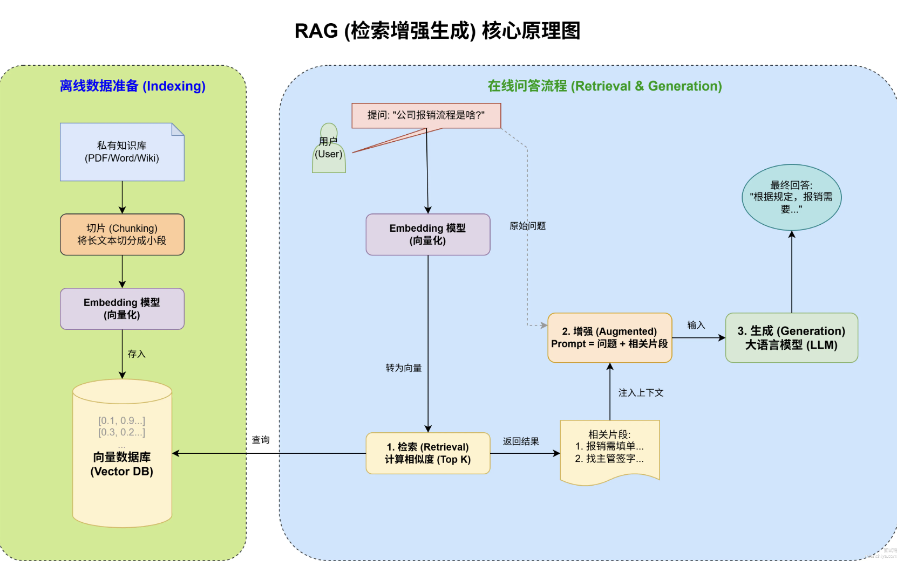

简单来说就是利用外部知识动态补充模型生成能力，既能保证回答的准确性，又能在知识库更新时及时反映最新信息。另外部分业务是内部文档，网上压根没有，可以通过本地知识库来增强 AI 的能力。

## 扩展知识

### 为什么会有 RAG

纯生成模型虽然能输出流畅的文本，但有两个致命问题：知识会过时、私有数据一无所知。传统做法是重新训练或者微调模型，但成本太高，一次微调可能要花几万甚至几十万。

RAG 换了个思路：模型能力不变，但给它配个 "外挂"，让它在回答之前先查资料。这样知识库更新了，模型不用动，直接就能用上新信息，**无需重新训练**。

### RAG 的详细工作流程

整个流程分四步：

第一步是文本向量化。用语义模型把文档和问题转成高维向量，常用的有 OpenAI 的 text-embedding-3-small/large 等。

第二步是向量数据库检索。用 Milvus 这类向量数据库存储所有文档向量，用户提问后对问题做向量化，然后在数据库里做最近邻搜索，找出语义最相近的 N 条内容。

第三步是构建 Prompt。把用户原始问题和检索到的内容拼接成上下文输入。

第四步是生成回答。由 GPT、Gemini 这类大模型综合上下文生成最终输出。

免费

### RAG 的局限性

RAG 不是万能的，有几个坑要注意：

1）检索质量决定上限。如果向量数据库里的文档本身质量差，或者 Embedding 模型语义理解不到位，检索出来的东西就是垃圾，大模型再厉害也没用

2）上下文窗口有限。大模型的输入长度是有限的，GPT-5 虽然支持 400K，但检索出来的内容太多塞不下，就得做截断或者 Rerank

3）实时性受限于索引更新。知识库更新后需要重新做 Embedding 入库，如果索引更新不及时，还是会答出过时的内容


### 面试官追问

**提问：如果检索出来的文档片段太多，超过了大模型的上下文窗口怎么办？**

回答：常见做法有三种。一是做 Rerank，用一个排序模型对检索结果重新打分，只保留最相关的 Top-K 条；二是做摘要压缩，对检索出来的长文档先跑一遍摘要，把信息密度提上去；三是分块处理，把问题拆成多个子问题分别检索回答，最后再做汇总。实际项目里 Rerank + Top-K 截断是最常用的组合。

**提问：RAG 和模型微调有什么区别？什么场景下该选哪个？**

详细解答可以看：RAG 和模型微调 Fine-tuning 有什么区别？如何选择？

回答：微调是把知识 "刻" 进模型参数里，适合需要改变模型行为风格或者学习特定任务模式的场景，比如让模型用特定语气说话。RAG 是把知识放在外部，适合知识会频繁更新、需要引用来源、或者私有数据量大的场景。微调一次成本高、知识更新要重新训练；RAG 只需要更新知识库，模型不用动。如果你的场景是 "让模型知道更多事实"，选 RAG；如果是 "让模型换一种方式说话"，选微调。

**提问：向量检索找到的内容语义相近，但可能不是真正相关的，怎么解决？**

回答：这是语义检索的经典问题，向量相似不等于真正相关。常见解决方案：一是混合检索，把向量检索和关键词检索结合起来，用 BM25 这类传统检索补一刀；二是加 Rerank 层，用交叉编码器对候选文档做精排，过滤掉语义漂移的结果；三是优化分块策略，文档切得太碎容易丢上下文，切得太大又不够精准，需要根据业务调整 chunk size 和 overlap。

## 二、什么是RAG中的Rerank？具体需要做什么？

### 回答重点

在 RAG 中，Rerank 是一个对初步检索返回的候选文档列表进行再次排序的过程。

我们可以把 RAG 的检索过程想象成公司招聘：

### 1）初步检索（Retrieval）

这就像是 HR 筛简历（海选）。HR 手里有几万份简历，她不可能每份都细看。她主要是看关键词，比如 Java、5 年经验。这样虽然速度快，但比较粗糙。有时候关键词匹配了，但其实候选人能力不行。

这就对应了我们常用的向量检索（Bi-Encoder），它算得快，但对语义理解没那么深。只能选出 Top 100 个看起来还行的候选人。

### 2）重排序（Rerank）

这就像是业务主管面试（精选）。主管把这 100 个人的简历拿来，一份份仔细读，甚至还要面对面聊（计算 Query 和 Document 的深层交互）。

因此速度慢，比较费脑子，但看得准。这就是 Rerank 模型（通常是 Cross-Encoder），它能精准判断这个文档是不是真的能回答用户的问题。即从 100 个人里挑出 Top 5 个最匹配的，最后喂给大模型去生成答案。

所以，Rerank 的核心价值就是在速度和精度之间做一个平衡。先用向量检索保速度，再用 Rerank 保精度，防止大模型因为看了垃圾文档而胡说八道

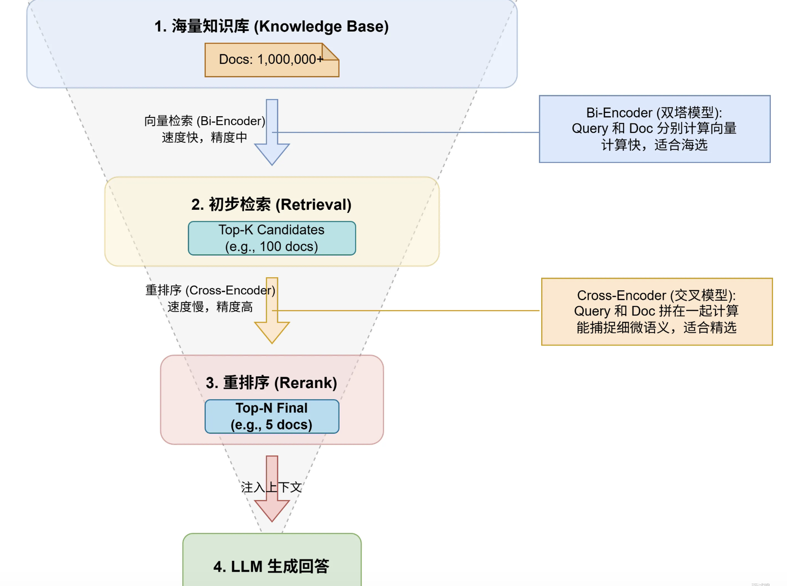

### 为什么需要 Rerank？如果没有 Rerank 会怎么样？

初步检索方法通常为了速度牺牲了一些精度，可能包含许多噪音文档。

而 Rerank 能够利用更高级的模型深入捕捉查询与文档之间的细微语义关系，从而筛除无关文档，确保生成模块获得高质量上下文信息。

如果没有 Rerank，生成模块可能基于噪音或不相关的文档生成回答，这会影响回答的准确性，甚至还可能引发误解。

### Rerank 通俗理解

在仓库里，你想要找 "坤你太美" 主题的周边玩具。仓库管理员先按照模糊标准，比如只要有 "坤" 字或者颜色鲜艳的都挑出来，给你抱来一堆。这堆里可能有篮球造型的小摆件、印有各种明星的卡片，还有一些卡通玩偶，很杂乱。

这时，Rerank 就像一位更专业的助手，它会把这堆东西重新审视，按照和 "坤你太美" 主题的贴合度重新排序。比如，印有蔡徐坤经典唱跳动作图案的扇子、模仿他舞台服装的小玩偶会被排在前面，而那些关联不大的就往后排。

排序完成后，不会把所有东西都给你，因为太多了看不过来。助手会把排在前几名、和 "坤你太美" 主题最贴近的周边拿给你，这样你就能快速找到自己真正想要的，不用在那一大堆杂乱物品里费劲翻找了。 :)

### 常见的 Rerank 模型

#### BAAI/bge-reranker-base （开源）

这是咱们北京智源人工智能研究院（BAAI）开发的交叉编码器模型，旨在对检索得到的候选文档进行重排序，以提高信息检索的精度。

链接：<https://huggingface.co/BAAI/bge-reranker-base>

BGE (BAAI General Embedding) 专注于检索增强 LLM 领域，目前包括以下项目:

Rerank 模型列表如下：

| Model                                    | Language            | Description                              |
| ---------------------------------------- | ------------------- | ---------------------------------------- |
| BAAI/bge-reranker-v2-m3                  | Multilingual        | 一个轻量级的交叉编码器模型，具有强大的多语言能力，易于部署，具有快速的推理能力。 |
| BAAI/bge-reranker-v2-gemma               | Multilingual        | 一个支持多语言的交叉编码器模型，在英文和多语言能力方面均表现出色。        |
| BAAI/bge-reranker-v2-minicpm-layerwise   | Multilingual        | 一个支持多语言的交叉编码器模型，在英文和中文方面均表现良好，允许自由选择输出层，以便加速推理。 |
| BAAI/bge-reranker-v2.5-gemma2-lightweight | Multilingual        | 一个支持多语言的跨编码器模型，不仅在英文和中文上表现良好，还允许自由选择输出层、压缩比例和压缩层，从而便于加速推理。 |
| BAAI/bge-reranker-large                  | Chinese and English | 交叉编码器模型，精度比向量模型更高但推理效率较低                 |
| BAAI/bge-reranker-base                   | Chinese and English | 交叉编码器模型，精度比向量模型更高但推理效率较低                 |

### Cohere – Reranker – v3.5

Reranker – v3.5 是 Cohere 这家公司是用于语义搜索和检索增强生成（RAG）的重排序模型，支持 100 多种语言，能处理长上下文（4K tokens），适用于代码检索、半结构化数据检索等复杂语义匹配场景，如法律文档分析、多语言问答等。

它不开源，所以没有链接了。

### 相关文档与扩展阅读链接

- Exploring the Effectiveness of Multi-stage Fine-tuning for Cross-encoder Re-rankers
- 1. 什么是 RAG？RAG 的主要流程是什么？
- Rerank——RAG 中百尺竿头更进一步的神器，从原理到解决方案

### 面试官追问

**提问：Rerank 的延迟一般有多少？对整体 RAG 系统性能影响大吗？**

回答：Cross-Encoder 的 Rerank 延迟通常在 50–200ms 左右，具体取决于模型大小和候选文档数量。如果召回 100 个文档，每个文档平均 500 tokens，用 bge-reranker-base 在 GPU 上跑大概 100ms 左右。对整体 RAG 系统来说，向量检索通常只要 10–50ms，Rerank 这一步反而成了瓶颈。所以要控制召回数量，一般 50–100 个就够了，不要贪多。

**提问：除了 Cross-Encoder，还有什么其他 Rerank 方案？**

回答：有几种。一是用 ColBERT 这类延迟交互相模型，它把 Document 的 token 级向量提前算好，Query 来了只需要做 token 级别的相似度匹配，比 Cross-Encoder 快很多但精度接近。二是用 LLM 直接做 Rerank，把候选文档和 Query 喂进去让它打分，效果好但成本高。三是基于规则的 Rerank，比如优先最近更新的文档、优先特定来源的文档，简单场景够用。

## 三、什么混合检索？在基于大模型的应用开发中，混合检索主要解决什么问题？

混合检索是指在 RAG 应用中，把向量检索和关键词检索结合起来，取长补短，提升检索结果的全面性和准确性。

为什么要混合？因为两种检索方式各有软肋：

向量检索擅长语义理解，比如 "猫捕猎老鼠" 和 "猫追逐老鼠" 能匹配上。但难以精准匹配专有名词比如 "iPhone 15"。

关键词检索正好反过来，精确匹配没问题，但理解不了语义，用户问 "怎么减肥"，它匹配不到 "如何瘦身"。

混合检索就是两条路并行走，向量检索走一遍，关键词检索走一遍，最后把两边的结果融合起来，用权重加权或者 RRF 算法重排序，取最优结果喂给大模型。

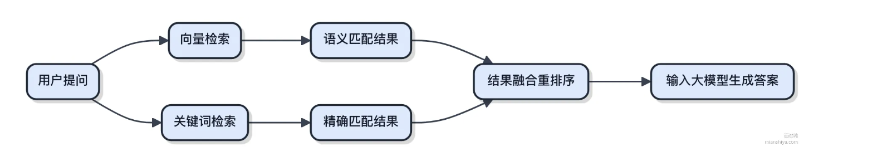

工程上 Elasticsearch 就同时支持关键词检索和向量检索，可以用 LlamaIndex + Elasticsearch 快速搭建混合检索系统。

### 扩展知识

#### 向量检索和关键词检索的优劣对比

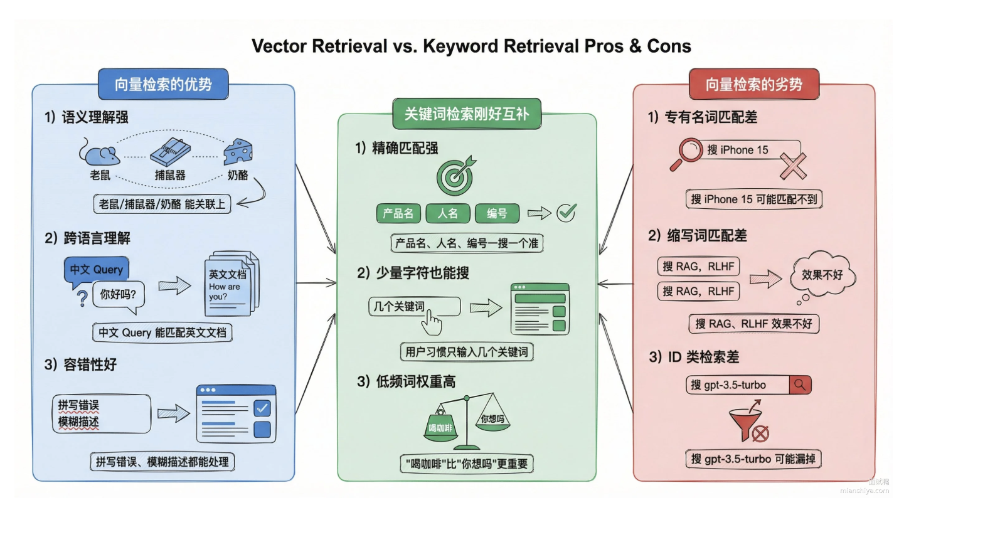

### 结果融合策略

两路检索的结果怎么合并是个技术活，常见做法有两种：

1）加权求和。给向量检索和关键词检索的分数分别乘以权重，加起来算总分。比如向量检索权重 0.7，关键词检索权重 0.3，最后按总分排序。权重怎么定？靠业务经验和 A/B 测试调。

2）RRF 算法，全称 Reciprocal Rank Fusion。不看分数只看排名，对每个文档算 1/(k+rank)，k 一般取 60，然后把两路的分数加起来。好处是不用关心两路检索分数的量纲差异，直接用排名算。

```python
# RRF 融合示例
def rrf_fusion(vector_results, keyword_results, k=60):
    scores = {}
    for rank, doc_id in enumerate(vector_results):
        scores[doc_id] = scores.get(doc_id, 0) + 1 / (k + rank + 1)
    for rank, doc_id in enumerate(keyword_results):
        scores[doc_id] = scores.get(doc_id, 0) + 1 / (k + rank + 1)
    return sorted(scores.items(), key=lambda x: -x[1])

```

### 混合检索的广义定义

混合检索也叫多路召回或者融合检索，不仅限于向量检索和关键词检索的叠加。

比如同时从文档库和数据库检索，或者同时用多个不同的 Embedding 模型做向量检索，最后把结果融合起来，都算混合检索。

只不过在大模型 RAG 场景下，混合检索最常见的形态就是向量检索 + 关键词检索。

### 工程实现方案

1）Elasticsearch 8.0+。原生支持 dense_vector 字段和 knn 查询，可以在一个查询里同时做向量检索和关键词检索，用 bool query 组合结果

2）Milvus + 外部搜索引擎。Milvus 专门做向量检索，配合 Elasticsearch 做关键词检索，应用层做融合

3）LlamaIndex / LangChain。这类框架封装了混合检索的能力，配置一下就能用，适合快速搭建原型

**提问：向量检索和关键词检索的权重一般怎么定？有什么调参技巧？**

回答：没有万能的黄金比例，得根据业务场景调。一般来说，如果你的文档里专有名词多、ID 类查询多，关键词检索权重可以调高到 0.4–0.5；如果主要是自然语言问答，向量检索权重可以给到 0.7–0.8。调参技巧是准备一批有标注的测试集，跑不同权重组合，看召回率和准确率的变化，找到最优点。线上还可以做 A/B 测试持续优化。

**提问：混合检索和 Rerank 是什么关系？能一起用吗？**

回答：能一起用，而且建议一起用。混合检索解决的是召回阶段的问题，让召回的候选文档更全面；Rerank 解决的是精排阶段的问题，让最终送给大模型的文档更精准。典型流程是：向量检索召回 Top 50，关键词检索召回 Top 50，RRF 融合后取 Top 100，然后用 Rerank 模型精排，最后取 Top 5 喂给大模型。两者是互补关系，不是替代关系。

**提问：如果关键词检索和向量检索的结果完全没有交集，怎么处理？**

回答：这种情况说明两路检索的视角差异很大，需要分情况处理。如果用户 Query 明显是搜专有名词或 ID，关键词检索的结果更可信，可以给关键词检索更高权重甚至只用关键词检索的结果。如果用户 Query 是自然语言问题，向量检索的结果更可信。还可以做个简单的 Query 分类器，判断 Query 类型后动态调整两路的权重。

## 四、RAG的完整流程是怎么样的

### 回答重点

RAG 的核心就是"先搜后答"，整个流程分成 **离线索引** 和 **在线问答** 两大阶段。

离线索引阶段做的是知识入库：

1）把原始文档清洗干净、切成 300–500 字的小块

2）用嵌入模型把每个文本块转向量

3）向量存进 Milvus 这类向量数据库，建好索引等着被搜

在线问答阶段处理用户请求：

1）用户提问进来，先把问题也转成向量

2）拿这个向量去数据库里做相似度检索，捞出最相关的 5–10 个文档块

3）对检索结果做重排序，把最相关的排前面

4）把用户问题和检索到的上下文一起塞给大模型，让它基于这些材料生成回答

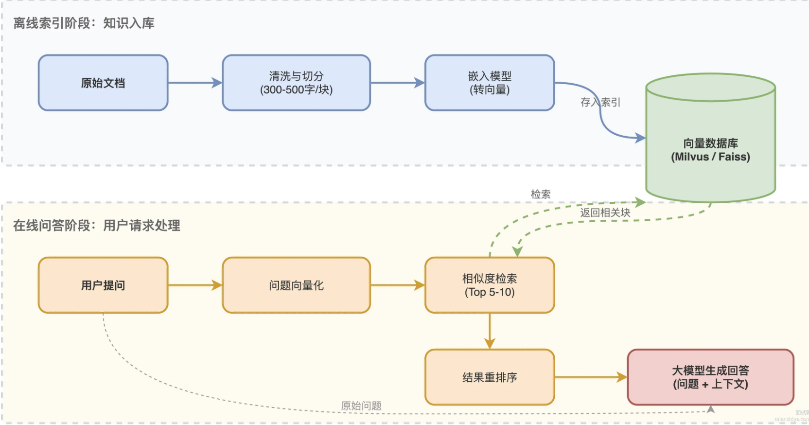

整个流程的精髓在于：大模型不再"裸奔"回答问题，而是带着检索到的知识去生成，既能减少幻觉，又能让回答有据可查。

### 扩展知识

#### 文档分块策略

分块是 RAG 效果的关键，块太大检索不精准，块太小又丢失上下文。常见的三种切法：

1）语义切分：用 SemanticSplitter 这类工具，保证每个块语义完整独立，比如一个问答对不会被切成两半

2）结构切分：HTML、PDF 这种有层级的文档，按标题层级切割，像 HTMLHeaderTextSplitter 就能保留文档结构

3）递归切分：RecursiveCharacterTextSplitter 先按大的分隔符切，切不动了再按小的切，兼顾连贯性和长度限制

实际项目里，300–500 字一块是比较通用的起点，具体要根据业务场景调。

#### 检索阶段的优化手段

单纯靠向量检索其实不够用，生产环境通常会做多路召回：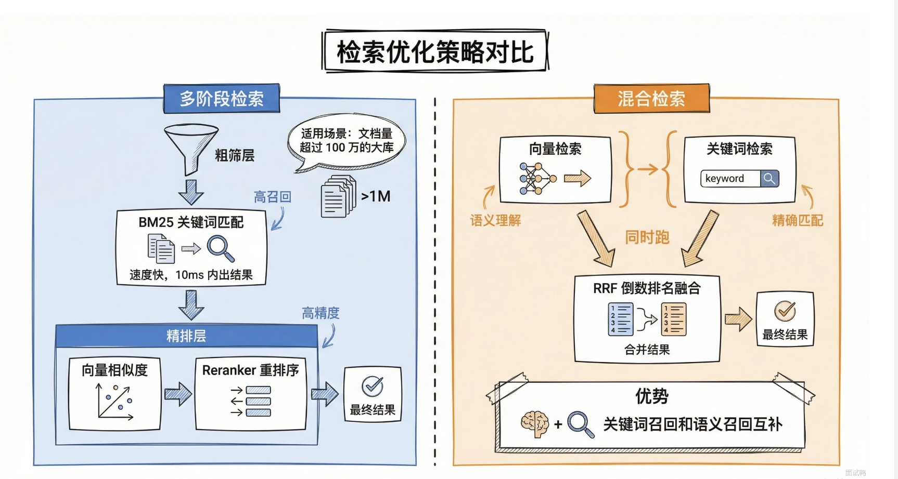

混合检索特别适合那种用户可能用专业术语搜索的场景，纯向量检索容易漏掉精确匹配的结果。

- 1. 什么混合检索？在基于大模型的应用开发中，混合检索主要解决什么问题？

#### Prompt 组装技巧

检索完拿到一堆文档块，怎么塞给大模型也有讲究：

```text
# 典型的 RAG Prompt 模板
prompt = """基于以下参考资料回答用户问题。如果资料中没有相关信息，请说明无法回答。

参考资料：
{context}

用户问题：{query}

回答："""

```

上下文太长会影响模型效果，超过 4000 token 的时候可以考虑做摘要压缩，RAPTOR 这类树状摘要方案就是干这个的。

#### 相关文档与扩展阅读链接

- RAG 原始论文：《Retrieval-Augmented Generation for Knowledge-Intensive NLP Tasks》

### 面试官追问

**提问：如果检索出来的文档和用户问题不太相关，大模型生成的答案会怎样？有什么办法缓解？**

回答：大模型会硬着头皮用这些不相关的内容去凑答案，结果就是回答跑偏或者出现幻觉。缓解手段主要有三个：

1）加一个相关性打分的环节，低于阈值的直接丢掉不给模型

2）在 Prompt 里明确告诉模型"如果资料不相关就直接说不知道"

3）用 Reranker 做二次排序，把真正相关的顶上来

**提问：向量检索和传统的关键词检索各有什么优缺点？**

回答：向量检索擅长语义理解，用户说"怎么退款"能搜到"退货流程"这种同义词的文档，但对精确匹配不敏感，搜"iPhone 15"可能漏掉带这个精确词的文档。关键词检索正好反过来，精确匹配很强但不懂语义，"退款"搜不到"退货"。所以生产环境一般两个一起用，取长补短。

**提问：文档块之间有上下文依赖怎么办？比如前一段说"它"，指的是更前面的某个概念。**

回答：这是分块策略的经典问题。常用的解法是加 overlap，相邻的块之间重叠 50–100 字，保证上下文不丢。更高级的做法是用 Parent-Child 结构，检索的时候匹配小块，返回给模型的时候带上它的父块，这样既精准又有上下文。

## 五、在RAG中为了优化检索精度，其中的数据清洗和预处理怎么做？

### 回答重点

#### 1、首先是数据接入与格式的统一

- **多源数据整合**：文档（PDF/Word）、表格（CSV/Excel）、网页（HTML）、API接口等，用工具（如PyPDF2、BeautifulSoup）提取纯文本。
- **格式标准化**：统一编码（UTF-8）、去除乱码（如"�"替换为空格）、转换大小写（统一小写避免"iPhone"和"iphone"被视为不同词）。

#### 2、开始清洗降噪，过滤无效信息

- **去除重复内容**（如文档中的页眉页脚、会议记录的重复发言）。
- **过滤噪声符号**（标点、特殊字符、markdown格式），保留核心文本。

还要注意**敏感信息处理**！用正则或库（如PII Detection）删除隐私数据（手机号、邮箱），避免泄露。

#### 3、需要进行分块

- 段落、章节标题、标点（句号/分号）切分，避免切断上下文（如"第一段前半+第二段后半"导致语义断裂）。
- 控制长度，比如单个知识块300-500字（约500-800 tokens），适配大模型上下文窗口（如GPT-4默认8k tokens，可放10-15个块）。

具体操作的时候，可以用 LlamaIndex 的 `RecursiveCharacterTextSplitter`（优先按标题/段落切分，再按字符数截断）、Hugging Face的 `TokenTextSplitter`（按token数切分）。

#### 4、元数据标注

- 用规则或LLM提取结构化信息（如文档中的"时间""地点""关键词标签"等元数据），作为检索时的过滤条件（如用户问"2025年的政策"，优先召回含"2025"元数据的块）。

- 最后就可以进行索引的构建了，为了用上混合检索，需要进行向量索引和关键词的倒排索引。

  流程示意如下：

  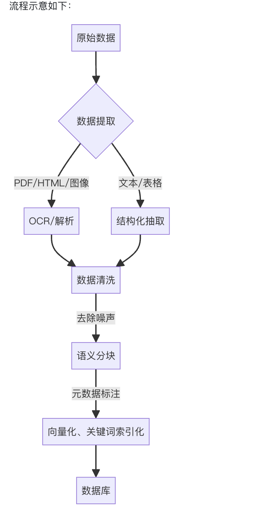

  ### 扩展知识

  数据预处理全流程拆解

  ```text
  原始数据（多格式）  
  │  
  ├─ 格式转换（提取纯文本）  
  │  ├─ PDF → PyPDF2提取文本  
  │  ├─ HTML → BeautifulSoup解析正文  
  │  └─ Excel → Pandas读取表格内容  
  │  
  ├─ 清洗降噪  
  │  ├─ 去除重复（相邻重复段落检测）  
  │  ├─ 过滤噪声（正则表达式去除标点、特殊符号）  
  │  └─ 敏感信息处理（PII检测库删除隐私数据）  
  │  
  ├─ 智能分块（核心步骤）  
  │  ├─ 动态切分：按“标题→段落→句子”优先级切分（如先按“### 第三章”分章节，再按句号分句）  
  │  ├─ 长度校验：单块不超过模型最大token数的60%（预留空间给用户问题和提示词）  
  │  └─ 重叠处理：相邻块保留10%重叠（如块1结尾100字作为块2开头，避免切断跨段语义）  
  │  
  ├─ 语义增强  
  │  ├─ 元数据标注：  
  │  │  ├─ 规则提取：用正则匹配“2024年”“张三”等实体  
  │  │  └─ LLM提取：用GPT-4生成“核心关键词”“所属部门”等标签  
  │  └─ 向量化：  
  │     ├─ 通用模型：Sentence-BERT（快速上线）  
  │     └─ 领域模型：BGE-M3（多语言）、ColBERTv2（长文本优化）  
  │  
  └─ 存储索引  
     ├─ 向量库：Milvus（高并发）  
     └─ 关键词库：Elasticsearch（BM25算法）+ 元数据索引（支持过滤查询）  

  ```

  ### 相关文档与扩展阅读链接

  - Hugging Face 数据预处理
  - 1. 什么混合检索？在基于大模型的应用开发中，混合检索主要解决什么问题？

  ### 面试官追问

  **提问：分块的时候重叠太多会有什么问题？不重叠又会怎样？**

  详细解答可以看：在 RAG 中，常见的分块策略有哪些？分别有什么区别？

  回答：重叠太多会导致相同的内容在多个块里重复出现，检索的时候召回一堆内容差不多的块，浪费 token 额度，还可能让模型产生"这段话好像说了好几遍"的困惑。不重叠的话，跨段落的语义就容易被切断，比如"它的优点是..."这句话里的"它"指的是上一段的某个概念，切断了就成了孤儿句。一般 10–15% 的重叠率是个平衡点。

  **提问：如果原始文档里有大量表格数据，怎么处理比较好？**

  回答：表格不能直接切成文本块，会丢失行列关系。常用的做法是把表格转成自然语言描述，比如"产品A的价格是100元，产品B的价格是200元"这种。或者保留表格的结构化形式，检索的时候单独处理，用 SQL 式的查询而不是向量检索。如果表格特别重要，可以考虑专门训练一个 Table QA 模型来处理。

  **提问：清洗过程中误删了重要信息怎么办？有没有什么保底措施？**

  回答：清洗规则上线前一定要在小样本上先跑一遍，人工抽检看看有没有误伤。保底措施是保留原始数据不删，清洗后的数据单独存一份，出问题了能回溯。还可以加一个"清洗日志"，记录每条数据被哪条规则处理过，方便排查。生产环境里我们还会定期抽样对比清洗前后的数据，监控误删率。

  ## 六、A2A协议的工作原理是什么？

  ### 回答重点

  A2A 协议的核心作用是让**客户端 Agent** 和**远程 Agent** 之间顺利沟通。客户端 Agent 负责创建并下发任务，远程 Agent 根据任务提供信息或执行操作。

  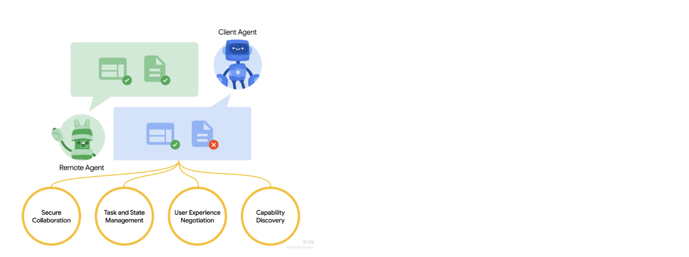

  整个过程中，A2A 提供了四个关键能力：

  1）**能力发现**：每个 Agent 都有一张 Agent Card，以 JSON 格式描述它能做什么。客户端 Agent 可以通过这些卡片，找到最适合执行当前任务的远程 Agent，并通过 A2A 协议与之建立通信。

  2）**任务管理**：客户端向远程 Agent 发送 Message，远程 Agent 根据请求内容自主决定是否创建 Task 来跟踪执行。每个 Task 都有协议定义的生命周期，有些任务可以立刻完成，对于耗时较长的任务，双方可以持续沟通、保持状态同步。任务完成后会产生一个 Artifact，也就是最终的执行结果。

  3）**协作能力**：Agent 之间可以直接通信，发送包含上下文、回复、Artifact 或用户指令的消息，便于协同完成更复杂的任务。

  4）**用户体验协商**：每条消息可以包含多个 Part，每个 Part 代表一个完整的内容片段，比如一张图片或一段文本。每个 Part 都有明确的 MIME 类型，客户端和远程 Agent 可以据此协商最合适的展示格式，支持 iframe、视频、网页表单等不同的 UI 形态。

  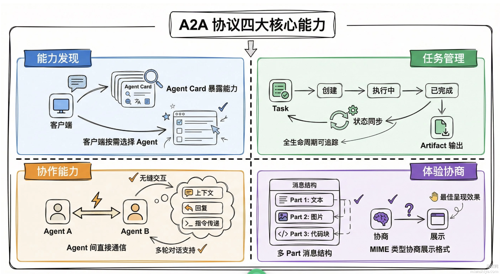

  ### 扩展知识

  #### 工作流程详解

  - 1. A2A 协议的工作流程是怎样的？

  #### 与传统 API 调用的区别

  | 维度   | 传统 API 调用 | A2A 协议           |
  | ---- | --------- | ---------------- |
  | 调用方式 | 同步请求–响应   | 支持异步 + 流式        |
  | 任务时长 | 通常秒级完成    | 支持长时间任务          |
  | 状态管理 | 无状态或自行管理  | 协议内置 Task 生命周期   |
  | 能力发现 | 靠文档或手动配置  | Agent Card 自动暴露  |
  | 内容格式 | 固定格式      | 多 Part + MIME 协商 |

  #### 相关资源

  1）Announcing the Agent2Agent Protocol (A2A) –How A2A works

  #### 面试官追问

  **提问：Agent Card 一般放在哪里，客户端怎么发现它？**

  回答：Agent Card 通常放在 Agent 服务的固定路径下，比如 `/.well-known/agent-card.json`，跟 OAuth 的 `.well-known/openid-configuration` 类似。客户端可以通过服务发现机制获取已知 Agent 的域名列表，然后逐个请求这个固定路径拿到 Agent Card。也可以搞一个中心化的 Agent 注册表，所有 Agent 启动后把自己的 Card 注册上去，客户端直接查注册表。

  **提问：Task 执行到一半远程 Agent 挂了怎么办？**

  回答：A2A 协议本身不强制规定容错策略，但提供了基础设施来支撑。Task 有唯一 ID，重启后可以恢复状态。如果远程 Agent 支持任务持久化，重启后能从中断点继续；如果不支持，客户端通过 GetTask（早期版本叫 tasks/get）查询会发现任务变成 failed 状态，然后可以决定是重新发起还是切换到其他 Agent。高可用场景下，建议远程 Agent 后面挂个任务队列，比如 Kafka 或 RabbitMQ，任务不会因为单点故障丢失。

  **提问：多个 Agent 协作时，消息上下文怎么传递的？**

  回答：每条 Message 里有一个 parts 数组，可以塞多个 Part。除了用户可见的内容，还可以用 data 类型的 Part 或 metadata 字段带上中间结果、任务上下文等；多轮交互则用同一个 contextId 串起来，远程 Agent 据此关联之前的对话。远程 Agent 收到消息后解析这些 Part，就能拿到完整的上下文。如果上下文太大，也可以只传引用，比如一个 URL 指向之前生成的 Artifact，远程 Agent 自己去拉取。

  ## 七、A2A协议的五大原则

  ### 回答重点

  A2A 协议就是 AI 智能体界的通用语言，目的是打破各个 Agent 框架之间的隔离，让它们能无障碍交流。设计上遵循了**五大核心原则**：

  1）**拥抱 Agentic 能力**：把 Agent 当人看，不是当工具用。传统 API 是我调你一下你动一下，A2A 允许 Agent 之间像同事一样协作，它们可以自己商量怎么完成任务，不需要共享内存，也不需要知道对方底层代码，只通过协议沟通就行。

  2）**建立在现有标准之上**：不造新轮子，底层用的就是 HTTP、SSE、JSON-RPC 这些成熟技术。企业现有的 IT 系统不用推倒重来，直接就能接入，开发成本极低。

  3）**默认安全**：企业最怕 AI 乱跑。A2A 直接集成了企业级的身份验证和授权机制，跟 OpenAPI 的安全标准看齐，确保 Agent 之间的交互是可控、可追溯的。

  4）**支持长时间运行的任务**：很多 AI 任务比如写代码、做研究可能要跑好几个小时。A2A 设计了异步机制，支持通过 SSE 实时反馈进度，用户不用傻等，可以随时查看状态。

  5）**模态无关**：不光能发文字，还能发语音、视频。A2A 原生支持音频、视频流传输，为未来的语音助手、视频分析 Agent 预留了接口。

  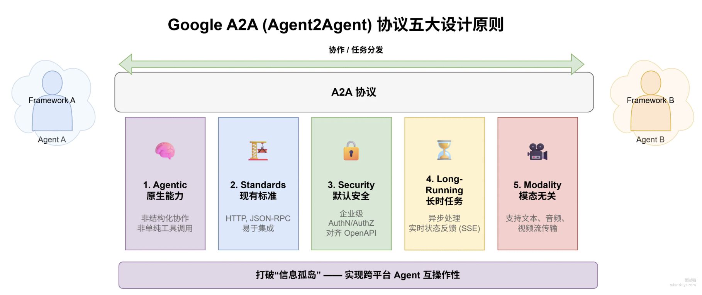

  简单来说，A2A 就是为了建立一个去中心化的 Agent 互联网，让不同厂商的 AI 能在一个安全、标准的框架下，进行长时间、多模态的自主协作。

  ### 扩展知识

  #### 为什么需要这五大原则

  在多智能体生态系统中，不同厂商和框架的 Agent 往往各自为政，形成"信息孤岛"，互相协作起来很费劲。Google 推出的 A2A 协议就是为了破解这个难题，目前已经有 Salesforce、SAP、MongoDB、PayPal 等 50 多家技术公司支持和贡献，目标是构建一个跨平台、跨供应商的智能体"自由贸易区"。

  #### 各原则的深层考量

  **拥抱智能体原生能力**这个原则，就好比在不同国家间制定统一的交往规则：每个 Agent 像外交官一样，带着自己的能力清单，即使没有共享的后端，也能通过统一协议自我介绍、商量任务、交换结果。这样不仅保持了灵活性，还让整个系统更有韧性，不会因为某个中心化部件出问题就全盘崩溃。

  **基于现有标准构建**是为了让实际落地时别变成一场烧脑的迁移大工程。A2A 借用了 HTTP 的通用性、SSE 的实时推送，以及 JSON-RPC 的调用规范，后端开发和运维都能在现有架构上直接接入，成本低还可靠。

  **默认安全**是把企业级的认证和授权直接内置到协议里，就像从一开始就设好了银行级的安全关卡，不用事后再补救。无论是身份验证、令牌管理，还是访问控制，都跟 OpenAPI 的最佳实践保持一致。

  **支持长时任务**是因为很多复杂流程不是一蹴而就的，比如科研建模或供应链优化，可能要花几小时甚至几天。A2A 在协议层面定义了任务生命周期和状态更新机制，用户能随时查进度、拿中间结果，不用干等着。

  **模态无关**的设计理念是适应智能世界越来越多元的趋势。除了基本的文本消息，A2A 原生支持音频和视频流的传输，将来还能扩展到图像、传感器数据等更多形式，虚拟助理、客服机器人、物联网设备都能用同一套协议协作。

  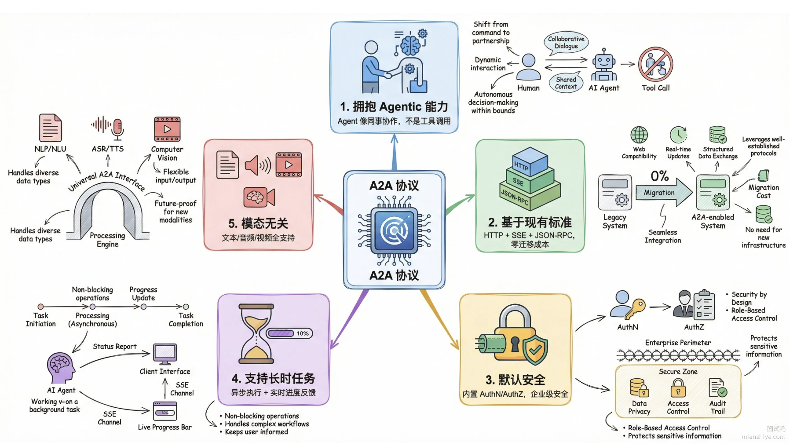

### 相关论文与扩展阅读链接

1）Announcing the Agent2Agent Protocol (A2A) – A2A design principles

### 面试官追问

**提问：A2A 协议怎么保证不同厂商实现的 Agent 真的能互通？**

回答：靠 Agent Card 这个机制。每个 Agent 必须发布一个标准格式的 JSON 文件，里面声明自己能干啥、接受什么输入、返回什么输出。客户端拿到 Agent Card 后就知道怎么调用这个 Agent，不管它底层是 LangChain 还是 AutoGPT 还是自研框架。协议层面强制规定了 JSON-RPC 2.0 的调用格式，只要遵守协议，互通就没问题。

**提问：默认安全这个原则具体怎么落地的？**

回答：A2A 协议在 Agent Card 里就要求声明支持哪些认证方式，比如 OAuth 2.0、API Key、mTLS 等。每次请求都必须带上认证信息，Server 端会校验。授权层面，Agent Card 也会声明哪些操作需要什么权限，客户端必须先拿到对应权限才能调用。整套机制跟 OpenAPI 的安全规范对齐，企业现有的 IAM 系统可以直接接管。

**提问：长时任务跑到一半客户端断线了怎么办？**

回答：Task 有唯一 ID，断线重连后通过 tasks/get 接口查询任务状态就行，不用重新发起。如果配置了 Push Notification，任务完成后服务端会主动往 webhook URL 推送结果。另外 A2A 协议支持任务状态持久化，Server 重启后任务信息也不会丢。